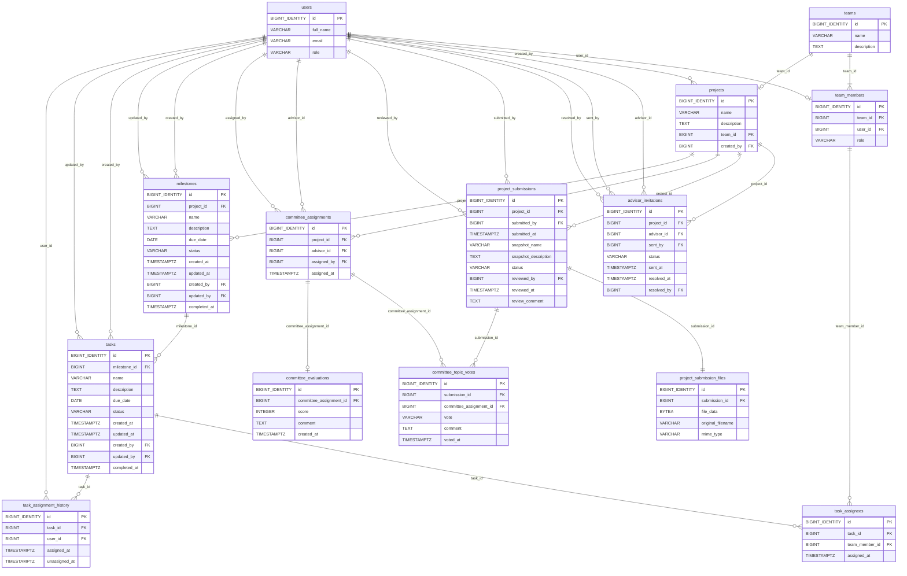

# Data Dictionary — Database Schema V1
**ระบบ:** Student Project Management System  
**สถานะ:** ข้อกำหนด Schema V1; อัปเดตเอกสารอ้างอิง 2026-11-06 ไม่เปลี่ยน Business Rules หรือ PostgreSQL  
**ฐานข้อกำหนด:** ข้อสรุป G-01 ถึง G-12, C-01 ถึง C-07 และ D-01 ที่ยืนยันในบทสนทนา (ข้อกำหนดที่ยืนยันภายหลังมีผลเหนือแบบ UI เก่า)

**ข้อยืนยันภายหลังที่รวมแล้ว:** R-01=A — ห้ามลบ Project ทุกกรณี; เป็นการรวมคำยืนยันเดิม ไม่เพิ่มกฎใหม่

อ่านร่วมกับ [Schema V1 Reference](SCHEMA_V1_REFERENCE.md), [SQL](../../database/schema/Database_Schema_V1_A02_A05_REVIEW_DRAFT.sql), [RBAC](../../database/schema/Database_Schema_V1_A02_A05_RBAC_REVIEW_TEMPLATE.sql), [Review Report](Database_Schema_V1_A02_A05_Review_Report.md) และ [Backlog](../progress/BACKLOG.md) สถานะทดสอบให้ดูรายงาน ไม่ตีความว่าเนื้อหา specification ทั้งหมดผ่าน runtime แล้ว

## 1. ภาพรวม
| ตาราง | จำนวน Columns | Foreign Keys | หน้าที่ |
|---|---:|---:|---|
| `users` | 4 | 0 | บัญชีผู้ใช้: นักศึกษา อาจารย์ และผู้ประสานงาน |
| `teams` | 3 | 0 | ข้อมูลทีมโครงงาน |
| `team_members` | 4 | 2 | ความเป็นสมาชิกปัจจุบันของทีม |
| `projects` | 5 | 2 | โครงงาน ทีมหนึ่งมีหนึ่งโครงงาน |
| `advisor_invitations` | 8 | 4 | ประวัติคำเชิญอาจารย์ที่ปรึกษา |
| `project_submissions` | 10 | 3 | การส่งหัวข้อแต่ละรอบพร้อม snapshot และผลตรวจอาจารย์ |
| `project_submission_files` | 5 | 1 | ไฟล์ส่งหัวข้อ PDF หรือ PPTX หนึ่งรายการต่อ Submission |
| `committee_assignments` | 5 | 3 | การแต่งตั้งกรรมการให้ Project |
| `committee_topic_votes` | 6 | 2 | ผลลงมติหัวข้อของกรรมการราย Submission |
| `committee_evaluations` | 5 | 1 | ผลคะแนนประเมินของกรรมการครั้งเดียวต่อการแต่งตั้ง |
| `milestones` | 11 | 3 | ชุดแผนงานของ Project; สถานะคำนวณจาก Tasks |
| `tasks` | 11 | 3 | งานย่อยภายใต้ Milestone |
| `task_assignees` | 4 | 2 | ผู้รับผิดชอบ Task ปัจจุบัน |
| `task_assignment_history` | 5 | 2 | ประวัติเมื่อผู้รับผิดชอบถูกถอนออกจาก Task |
| **รวม** | **86** | **28** | **14 ตาราง** |

**กฎร่วม:** ทุกตารางใช้ `id BIGINT GENERATED ALWAYS AS IDENTITY PRIMARY KEY`; ค่า `—` ใน DEFAULT หมายถึงไม่มี SQL DEFAULT ที่ยืนยันไว้ (ไม่ใช่ให้ใส่ค่า NULL); `NULL` ระบุเฉพาะ Column ที่ยอมรับค่าว่าง; `FK` อ้างอิง Relationship ใน ER Diagram

## 2. ER Diagram
ERD แบบ Mermaid อยู่ใน code block ด้านล่างและแก้ไขได้ในเอกสารนี้ ส่วนไฟล์แยก `Database_Schema_V1_ER_Diagram.mmd` และภาพ SVG/PNG ที่เคยอ้างถึงไม่พบใน Workspace ณ วันที่ตรวจ จึงเป็น Not Verified

## 3. Data Dictionary รายตาราง

### 01. `users`
บัญชีผู้ใช้: นักศึกษา อาจารย์ และผู้ประสานงาน

| Column | Data Type | NULL | DEFAULT | Key / Reference | กฎและความหมาย |
|---|---|---|---|---|---|
| `id` | `BIGINT GENERATED ALWAYS AS IDENTITY` | NO | `IDENTITY` | PK | Primary Key |
| `full_name` | `VARCHAR(255)` | NO | `—` | — | Trim และห้ามข้อความว่าง |
| `email` | `VARCHAR(255)` | NO | `—` | UNIQUE | Trim, lowercase, UNIQUE; Backend ตรวจรูปแบบอีเมล; PostgreSQL บังคับ lowercase |
| `role` | `VARCHAR(30)` | NO | `—` | — | CHECK: student / advisor / coordinator; ไม่มี DEFAULT และห้ามเปลี่ยนหลังสร้าง |

### 02. `teams`
ข้อมูลทีมโครงงาน

| Column | Data Type | NULL | DEFAULT | Key / Reference | กฎและความหมาย |
|---|---|---|---|---|---|
| `id` | `BIGINT GENERATED ALWAYS AS IDENTITY` | NO | `IDENTITY` | PK | Primary Key |
| `name` | `VARCHAR(255)` | NO | `—` | — | Trim ห้ามข้อความว่าง; ชื่อซ้ำระหว่างทีมได้ |
| `description` | `TEXT` | YES | `—` | — | Trim; ข้อความว่างเก็บ NULL |

### 03. `team_members`
ความเป็นสมาชิกปัจจุบันของทีม

| Column | Data Type | NULL | DEFAULT | Key / Reference | กฎและความหมาย |
|---|---|---|---|---|---|
| `id` | `BIGINT GENERATED ALWAYS AS IDENTITY` | NO | `IDENTITY` | PK | Primary Key |
| `team_id` | `BIGINT` | NO | `—` | FK → `teams.id` (`ON DELETE CASCADE`) | ห้ามเปลี่ยนหลัง INSERT; ทีมต้องมีสมาชิก >=1 ขณะ COMMIT |
| `user_id` | `BIGINT` | NO | `—` | FK → `users.id` (`ON DELETE RESTRICT`); UNIQUE | UNIQUE; ห้ามเปลี่ยนหลัง INSERT; ต้องเป็น users.role=student |
| `role` | `VARCHAR(20)` | NO | `—` | — | CHECK: leader / member; ไม่มี DEFAULT; เปลี่ยนได้เฉพาะโอนหัวหน้าที่อนุญาต |

### 04. `projects`
โครงงาน ทีมหนึ่งมีหนึ่งโครงงาน

| Column | Data Type | NULL | DEFAULT | Key / Reference | กฎและความหมาย |
|---|---|---|---|---|---|
| `id` | `BIGINT GENERATED ALWAYS AS IDENTITY` | NO | `IDENTITY` | PK | Primary Key |
| `name` | `VARCHAR(255)` | NO | `—` | — | Trim ห้ามข้อความว่าง |
| `description` | `TEXT` | YES | `—` | — | Trim; ว่างเป็น NULL |
| `team_id` | `BIGINT` | NO | `—` | FK → `teams.id` (`ON DELETE RESTRICT`); UNIQUE | UNIQUE; ต้องมีทีมก่อนสร้าง Project |
| `created_by` | `BIGINT` | NO | `—` | FK → `users.id` (`ON DELETE RESTRICT`) | หัวหน้าทีมผู้สร้างจริง; ห้ามเปลี่ยนหลัง INSERT |

### 05. `advisor_invitations`
ประวัติคำเชิญอาจารย์ที่ปรึกษา

| Column | Data Type | NULL | DEFAULT | Key / Reference | กฎและความหมาย |
|---|---|---|---|---|---|
| `id` | `BIGINT GENERATED ALWAYS AS IDENTITY` | NO | `IDENTITY` | PK | Primary Key |
| `project_id` | `BIGINT` | NO | `—` | FK → `projects.id` (`ON DELETE RESTRICT`) | Project ที่ส่งคำเชิญ; ห้ามเปลี่ยน |
| `advisor_id` | `BIGINT` | NO | `—` | FK → `users.id` (`ON DELETE RESTRICT`) | ต้องมี users.role=advisor; ห้ามเปลี่ยน |
| `sent_by` | `BIGINT` | NO | `—` | FK → `users.id` (`ON DELETE RESTRICT`) | หัวหน้าทีมผู้ส่งจริง; immutable |
| `status` | `VARCHAR(20)` | NO | `'pending'` | — | CHECK: pending / accepted / rejected / cancelled; PostgreSQL บังคับค่าเริ่ม pending; สถานะสิ้นสุดเปลี่ยนไม่ได้ |
| `sent_at` | `TIMESTAMPTZ` | NO | `NOW()` | — | เวลาส่งจาก PostgreSQL; immutable |
| `resolved_at` | `TIMESTAMPTZ` | YES | `—` | — | NULL เมื่อ pending; PostgreSQL เติมเวลาเมื่อสรุป; ต้อง >= sent_at |
| `resolved_by` | `BIGINT` | YES | `—` | FK → `users.id` (`ON DELETE RESTRICT`) | NULL เมื่อ pending; หากตอบรับ/ปฏิเสธ = advisor_id; หากยกเลิก = หัวหน้าทีมปัจจุบัน |

### 06. `project_submissions`
การส่งหัวข้อแต่ละรอบพร้อม snapshot และผลตรวจอาจารย์

| Column | Data Type | NULL | DEFAULT | Key / Reference | กฎและความหมาย |
|---|---|---|---|---|---|
| `id` | `BIGINT GENERATED ALWAYS AS IDENTITY` | NO | `IDENTITY` | PK | Primary Key |
| `project_id` | `BIGINT` | NO | `—` | FK → `projects.id` (`ON DELETE RESTRICT`) | Project ที่ส่ง; immutable |
| `submitted_by` | `BIGINT` | NO | `—` | FK → `users.id` (`ON DELETE RESTRICT`) | หัวหน้าทีมปัจจุบัน ณ เวลาส่ง; immutable |
| `submitted_at` | `TIMESTAMPTZ` | NO | `NOW()` | — | เวลาส่งจาก PostgreSQL; immutable |
| `snapshot_name` | `VARCHAR(255)` | NO | `—` | — | คัดลอกจาก projects.name เมื่อส่ง; immutable |
| `snapshot_description` | `TEXT` | YES | `—` | — | คัดลอกจาก projects.description เมื่อส่ง; immutable |
| `status` | `VARCHAR(30)` | NO | `'pending_review'` | — | CHECK: pending_review / approved / revision_requested; PostgreSQL บังคับค่าเริ่มต้น; ตรวจได้ครั้งเดียว |
| `reviewed_by` | `BIGINT` | YES | `—` | FK → `users.id` (`ON DELETE RESTRICT`) | NULL เมื่อ pending_review; เมื่อสิ้นสุดต้องเป็นอาจารย์ที่ปรึกษาที่ตอบรับของ Project |
| `reviewed_at` | `TIMESTAMPTZ` | YES | `—` | — | NULL เมื่อ pending_review; ตั้งโดย PostgreSQL เมื่อสรุป; >= submitted_at |
| `review_comment` | `TEXT` | YES | `—` | — | NULL เมื่อ pending; ขอแก้ไขต้องมีข้อความจริง; approved จะมี/ไม่มีได้; Trim |

### 07. `project_submission_files`
ไฟล์ส่งหัวข้อ PDF หรือ PPTX หนึ่งรายการต่อ Submission

| Column | Data Type | NULL | DEFAULT | Key / Reference | กฎและความหมาย |
|---|---|---|---|---|---|
| `id` | `BIGINT GENERATED ALWAYS AS IDENTITY` | NO | `IDENTITY` | PK | Primary Key |
| `submission_id` | `BIGINT` | NO | `—` | FK → `project_submissions.id` (`ON DELETE RESTRICT`); UNIQUE | UNIQUE; ทุก Submission ต้องมีไฟล์หนึ่งรายการเมื่อ COMMIT |
| `file_data` | `BYTEA` | NO | `—` | — | CHECK: octet_length(file_data) BETWEEN 1 AND 4000000 |
| `original_filename` | `VARCHAR(255)` | NO | `—` | — | Trim ห้ามว่าง; นามสกุล .pdf/.pptx ต้องตรง MIME และเนื้อหา |
| `mime_type` | `VARCHAR(100)` | NO | `—` | — | เฉพาะ MIME ของ PDF/PPTX; ต้องตรงนามสกุลและเนื้อหาจริง |

### 08. `committee_assignments`
การแต่งตั้งกรรมการให้ Project

| Column | Data Type | NULL | DEFAULT | Key / Reference | กฎและความหมาย |
|---|---|---|---|---|---|
| `id` | `BIGINT GENERATED ALWAYS AS IDENTITY` | NO | `IDENTITY` | PK | Primary Key |
| `project_id` | `BIGINT` | NO | `—` | FK → `projects.id` (`ON DELETE RESTRICT`) | UNIQUE ร่วมกับ advisor_id; โครงงานที่รับแต่งตั้ง |
| `advisor_id` | `BIGINT` | NO | `—` | FK → `users.id` (`ON DELETE RESTRICT`) | ผู้ได้รับแต่งตั้งต้อง role=advisor; ไม่เป็นที่ปรึกษาของ Project เดียวกัน |
| `assigned_by` | `BIGINT` | NO | `—` | FK → `users.id` (`ON DELETE RESTRICT`) | ผู้ประสานงานที่แต่งตั้งจริง; immutable |
| `assigned_at` | `TIMESTAMPTZ` | NO | `NOW()` | — | เวลาที่ PostgreSQL กำหนด; immutable |

### 09. `committee_topic_votes`
ผลลงมติหัวข้อของกรรมการราย Submission

| Column | Data Type | NULL | DEFAULT | Key / Reference | กฎและความหมาย |
|---|---|---|---|---|---|
| `id` | `BIGINT GENERATED ALWAYS AS IDENTITY` | NO | `IDENTITY` | PK | Primary Key |
| `submission_id` | `BIGINT` | NO | `—` | FK → `project_submissions.id` (`ON DELETE RESTRICT`) | UNIQUE ร่วมกับ committee_assignment_id; ต้องเป็นรอบล่าสุดที่อาจารย์อนุมัติ |
| `committee_assignment_id` | `BIGINT` | NO | `—` | FK → `committee_assignments.id` (`ON DELETE RESTRICT`) | สมาชิกกรรมการของ Project เดียวกัน; ห้ามลงมติซ้ำในรอบ |
| `vote` | `VARCHAR(30)` | NO | `—` | — | CHECK: approved / revision_requested; ไม่มี DEFAULT |
| `comment` | `TEXT` | YES | `—` | — | Trim; approved ว่างเป็น NULL; revision_requested ต้องมีข้อความจริง |
| `voted_at` | `TIMESTAMPTZ` | NO | `NOW()` | — | เวลาลงมติจาก PostgreSQL; immutable |

### 10. `committee_evaluations`
ผลคะแนนประเมินของกรรมการครั้งเดียวต่อการแต่งตั้ง

| Column | Data Type | NULL | DEFAULT | Key / Reference | กฎและความหมาย |
|---|---|---|---|---|---|
| `id` | `BIGINT GENERATED ALWAYS AS IDENTITY` | NO | `IDENTITY` | PK | Primary Key |
| `committee_assignment_id` | `BIGINT` | NO | `—` | FK → `committee_assignments.id` (`ON DELETE RESTRICT`); UNIQUE | UNIQUE; กรรมการหนึ่งคนให้คะแนนหนึ่งครั้งต่อ Project |
| `score` | `INTEGER` | NO | `—` | — | CHECK: 0 ถึง 100; ไม่มี DEFAULT |
| `comment` | `TEXT` | NO | `—` | — | Trim และ CHECK ห้ามว่าง/ช่องว่างล้วน; ไม่มี DEFAULT; immutable |
| `created_at` | `TIMESTAMPTZ` | NO | `NOW()` | — | เวลาประเมินจาก PostgreSQL; immutable |

### 11. `milestones`
ชุดแผนงานของ Project; สถานะคำนวณจาก Tasks

| Column | Data Type | NULL | DEFAULT | Key / Reference | กฎและความหมาย |
|---|---|---|---|---|---|
| `id` | `BIGINT GENERATED ALWAYS AS IDENTITY` | NO | `IDENTITY` | PK | Primary Key |
| `project_id` | `BIGINT` | NO | `—` | FK → `projects.id` (`ON DELETE RESTRICT`) | Project เจ้าของ; immutable |
| `name` | `VARCHAR(255)` | NO | `—` | — | Trim ไม่ว่าง; UNIQUE (project_id, LOWER(name)) |
| `description` | `TEXT` | YES | `—` | — | Trim; ว่างเป็น NULL |
| `due_date` | `DATE` | NO | `—` | — | สร้าง/แก้ต้องไม่ก่อนวันปัจจุบันใน Asia/Bangkok; ไม่อนุญาตย่อวันที่จน Task เกินกำหนดใหม่ (D-01) |
| `status` | `VARCHAR(20)` | NO | `'not_started'` | — | CHECK: not_started/in_progress/completed; คำนวณจาก Task; ห้ามเปลี่ยนตรงโดยผู้ใช้ |
| `created_at` | `TIMESTAMPTZ` | NO | `NOW()` | — | PostgreSQL กำหนดเมื่อสร้าง; immutable |
| `updated_at` | `TIMESTAMPTZ` | NO | `NOW()` | — | PostgreSQL อัปเดตเมื่อข้อมูล Milestone เปลี่ยนจริง |
| `created_by` | `BIGINT` | NO | `—` | FK → `users.id` (`ON DELETE RESTRICT`) | หัวหน้าทีมผู้สร้างจริง; immutable |
| `updated_by` | `BIGINT` | YES | `—` | FK → `users.id` (`ON DELETE RESTRICT`) | NULL เมื่อสร้าง; ผู้ดำเนินการที่ทำให้เกิดการเปลี่ยนจริง; Actor จาก Transaction Context |
| `completed_at` | `TIMESTAMPTZ` | YES | `—` | — | PostgreSQL ใส่เมื่อ completed, เคลียร์เมื่อกลับจาก completed |

### 12. `tasks`
งานย่อยภายใต้ Milestone

| Column | Data Type | NULL | DEFAULT | Key / Reference | กฎและความหมาย |
|---|---|---|---|---|---|
| `id` | `BIGINT GENERATED ALWAYS AS IDENTITY` | NO | `IDENTITY` | PK | Primary Key |
| `milestone_id` | `BIGINT` | NO | `—` | FK → `milestones.id` (`ON DELETE RESTRICT`) | Milestone เจ้าของ; immutable |
| `name` | `VARCHAR(255)` | NO | `—` | — | Trim ไม่ว่าง; UNIQUE (milestone_id, LOWER(name)) |
| `description` | `TEXT` | YES | `—` | — | Trim; ว่างเป็น NULL |
| `due_date` | `DATE` | YES | `—` | — | ถ้าระบุ ต้อง >= วันนี้ใน Asia/Bangkok เมื่อสร้าง/แก้ และ <= milestones.due_date |
| `status` | `VARCHAR(20)` | NO | `'not_started'` | — | CHECK: not_started/in_progress/completed; transitions ตาม G-09 |
| `created_at` | `TIMESTAMPTZ` | NO | `NOW()` | — | PostgreSQL กำหนดเมื่อสร้าง; immutable |
| `updated_at` | `TIMESTAMPTZ` | NO | `NOW()` | — | PostgreSQL อัปเดตเมื่อข้อมูล Task เปลี่ยนจริง; ไม่เปลี่ยนเพราะมอบหมายอย่างเดียว |
| `created_by` | `BIGINT` | NO | `—` | FK → `users.id` (`ON DELETE RESTRICT`) | หัวหน้าทีมผู้สร้างจริง; immutable |
| `updated_by` | `BIGINT` | YES | `—` | FK → `users.id` (`ON DELETE RESTRICT`) | NULL เมื่อสร้าง; ผู้แก้ไขจริง |
| `completed_at` | `TIMESTAMPTZ` | YES | `—` | — | PostgreSQL ใส่เมื่อ completed, เคลียร์เมื่อเปิดใหม่ |

### 13. `task_assignees`
ผู้รับผิดชอบ Task ปัจจุบัน

| Column | Data Type | NULL | DEFAULT | Key / Reference | กฎและความหมาย |
|---|---|---|---|---|---|
| `id` | `BIGINT GENERATED ALWAYS AS IDENTITY` | NO | `IDENTITY` | PK | Primary Key |
| `task_id` | `BIGINT` | NO | `—` | FK → `tasks.id` (`ON DELETE CASCADE`) | UNIQUE ร่วมกับ team_member_id |
| `team_member_id` | `BIGINT` | NO | `—` | FK → `team_members.id` (`ON DELETE RESTRICT`) | ต้องเป็นสมาชิกปัจจุบันของทีมเจ้าของ Task; UNIQUE ร่วมกับ task_id |
| `assigned_at` | `TIMESTAMPTZ` | NO | `NOW()` | — | PostgreSQL กำหนดเวลามอบหมาย; immutable |

### 14. `task_assignment_history`
ประวัติเมื่อผู้รับผิดชอบถูกถอนออกจาก Task

| Column | Data Type | NULL | DEFAULT | Key / Reference | กฎและความหมาย |
|---|---|---|---|---|---|
| `id` | `BIGINT GENERATED ALWAYS AS IDENTITY` | NO | `IDENTITY` | PK | Primary Key |
| `task_id` | `BIGINT` | NO | `—` | FK → `tasks.id` (`ON DELETE CASCADE`) | ลบประวัติพร้อม Task เมื่ออนุญาตให้ลบ Task |
| `user_id` | `BIGINT` | NO | `—` | FK → `users.id` (`ON DELETE RESTRICT`) | ผู้ใช้เดิมที่ถูกถอน (ไม่ใช่ team_members.id) |
| `assigned_at` | `TIMESTAMPTZ` | NO | `—` | — | คัดลอกเวลามอบหมายจาก task_assignees ก่อนถอน; ไม่มี DEFAULT |
| `unassigned_at` | `TIMESTAMPTZ` | NO | `—` | — | PostgreSQL NOW() เมื่อถอน; CHECK: unassigned_at >= assigned_at |

## 4. Cross-row, Index และ Business Rules ที่ไม่อยู่ใน Column เดี่ยว
### 4.1 Keys และ Unique indexes
- `users.email` เป็น UNIQUE และบันทึก lowercase; ตรวจรูปแบบใน Backend
- `team_members.user_id` UNIQUE: ผู้ใช้หนึ่งคนมีความเป็นสมาชิกปัจจุบันได้สูงสุดหนึ่งทีม
- Partial UNIQUE บน `team_members(team_id) WHERE role = 'leader'`; Deferred Constraint Trigger ตรวจว่าแต่ละทีมที่ยังอยู่มีหัวหน้า 1 คนและสมาชิก >= 1 เมื่อ COMMIT
- `projects.team_id` UNIQUE: หนึ่งทีมมี Project ได้หนึ่งรายการ
- Partial UNIQUE บน `advisor_invitations(project_id) WHERE status IN ('pending', 'accepted')`
- Partial UNIQUE บน `project_submissions(project_id) WHERE status = 'pending_review'`
- `project_submission_files.submission_id` UNIQUE และ Deferred Constraint Trigger ตรวจว่าทุก Submission ใหม่มีไฟล์หนึ่งรายการตอน COMMIT
- `committee_assignments(project_id, advisor_id)` UNIQUE
- `committee_topic_votes(submission_id, committee_assignment_id)` UNIQUE
- `committee_evaluations.committee_assignment_id` UNIQUE
- `milestones(project_id, LOWER(name))` และ `tasks(milestone_id, LOWER(name))` UNIQUE แบบไม่แยกตัวพิมพ์ใหญ่เล็ก
- `task_assignees(task_id, team_member_id)` UNIQUE

### 4.2 Workflow และสถานะ
- C-01: ต้องสร้างทีมก่อนสร้าง Project; เฉพาะหัวหน้าทีมจัดการข้อมูลทีมและ Project ตามสถานะที่อนุญาต; ลบทีมได้เฉพาะกรณีไม่มี Project
- R-01=A: ห้ามลบ Project ทุกกรณี รวม Project ที่ยังไม่ส่งหัวข้อและไม่มีข้อมูลลูก; ไม่มี Project DELETE API/สิทธิ์ DELETE ของ app และ SQL มี Trigger ปฏิเสธ DELETE
- การแก้ชื่อ/คำอธิบาย Team และ Project: ล็อกหลังอาจารย์อนุมัติหัวข้อ; เปิดให้แก้อีกครั้งเมื่อกรรมการสรุปขอแก้ไข; ล็อกถาวรหลังกรรมการอนุมัติหัวข้อ
- C-07: การเพิ่มสมาชิกทำได้ในช่วงก่อนส่งครั้งแรก ระหว่างแก้ไขตามอาจารย์ หรือหลังกรรมการให้แก้ไขแต่ก่อนส่งรอบใหม่; ห้ามเพิ่มระหว่างรอตรวจหรือหลังอนุมัติ
- G-03: ห้ามแก้ `team_members.team_id` และ `user_id` หลังสร้าง; ผู้อยู่ในทีมต้องเป็น student; โอนหัวหน้าผ่าน Transaction ที่ล็อกแถวทีมเท่านั้น
- Advisor Invitation: `pending → accepted/rejected/cancelled`; บันทึก `resolved_by/at` ครบคู่; กฎ `resolved_at >= sent_at`; หลัง `accepted` ไม่เปลี่ยนอาจารย์ใน V1
- Submission: ต้องมี advisor invitation ที่ accepted และผู้ส่งเป็นหัวหน้าปัจจุบัน; สร้างกับไฟล์หนึ่งไฟล์ใน Transaction; รอบล่าสุดคือ max(id) ใน Project; ห้าม DELETE ทุกสถานะ; Snapshot คงเดิม
- การตรวจ Submission: `pending_review → approved/revision_requested` ได้ครั้งเดียว; ข้อความเมื่อขอแก้ไขห้ามว่าง; `reviewed_at >= submitted_at`
- Committee: ผู้ประสานงานแต่งตั้งหลังมี Submission ที่อาจารย์อนุมัติ; >=3 กรรมการก่อน Vote แรก; หลัง Vote แรกห้ามเปลี่ยนรายชื่อถาวร
- Vote: เฉพาะ Submission ล่าสุดที่อาจารย์อนุมัติ; กรรมการหนึ่งคนต่อรอบหนึ่ง Vote; สรุปเมื่อกรรมการทั้งหมดลงมติครบ และ approved > 50%; ผลสรุปคำนวณจากข้อมูล ไม่เพิ่ม Column
- Evaluation: บันทึกได้เมื่อหัวข้อผ่านกรรมการและมี Milestone completed >=1; หนึ่งการแต่งตั้งหนึ่ง Evaluation; ผลรวมและค่าเฉลี่ยคำนวณเมื่อกรรมการให้คะแนนครบ โดยค่าเฉลี่ยปัดเป็นจำนวนเต็ม; ห้าม UPDATE/DELETE
- Milestone: สถานะอนุมานจาก Task — ไม่มี Task/ทุก Task not_started = not_started; ทุก Task completed = completed; กรณีอื่น = in_progress; ห้ามแก้ status โดยตรง
- Task: not_started→completed ได้ถ้ามีผู้รับผิดชอบ >=1; in_progress→not_started ได้; completed→not_started ไม่ได้; completed→in_progress เฉพาะหัวหน้า; in_progress ต้องมีผู้รับผิดชอบ >=1; Task ที่ completed ห้ามแก้ข้อมูลปกติจนกว่าจะเปิดใหม่
- D-01: เมื่อแก้ milestones.due_date ถ้ามี Task ใด due_date > วันที่ใหม่ ให้ปฏิเสธ; ไม่ปรับ Task อัตโนมัติ
- C-02: การออกจากทีมต้องไม่ทำให้ Task in_progress เหลือผู้รับผิดชอบ 0; not_started/completed อาจเหลือ 0 จากการออกจากทีมได้
- หลังกรรมการบันทึก Evaluation แรก: ห้ามเพิ่ม/แก้/ลบ Milestone, Task และแก้ Assignee ตามปกติ ยกเว้นถอน assignee ที่เกิดจากสมาชิกออกจากทีมตามกระบวนการอนุญาต
- `task_assignment_history` เขียนเฉพาะเมื่อถอนผู้รับผิดชอบ; `assigned_at` คัดลอกจาก assignee; `unassigned_at` เป็นเวลา PostgreSQL; การลบ Task ใช้ CASCADE โดยไม่สร้างประวัติถอนงานเทียม

### 4.3 File & API
- Browser (Next.js) ส่งไฟล์ Binary `multipart/form-data` ตรงไป FastAPI; ไม่ส่ง Base64 JSON และไม่ผ่าน Next.js Server เป็นตัวกลาง
- PDF/PPTX เท่านั้น; นามสกุล MIME และเนื้อหาจริงต้องตรงกัน; File bytes 1 ถึง 4,000,000; Backend อ่านเป็น Chunk และตอบ 413 หากเกิน
- PostgreSQL CHECK `octet_length(file_data) BETWEEN 1 AND 4000000`; ต้องมีไฟล์หนึ่งไฟล์ต่อ Submission; ไม่อนุญาต UPDATE/DELETE ไฟล์หลังสร้าง
- ดาวน์โหลดผ่าน FastAPI โดยตรวจสิทธิ์ทุกครั้งและตอบ `Content-Disposition: attachment` ไม่ใช้ public download URL

### 4.4 Access control (G-12)
- Backend ตรวจสิทธิ์ตาม Role/Project ทุกคำขอ ไม่ใช้ PostgreSQL RLS ใน V1; จำกัดสิทธิ์บัญชี DB ของแอปและไม่ให้ Browser เชื่อม DB ตรง
- เมื่อไม่มีสิทธิ์รับรู้ว่าข้อมูลมีอยู่ หรือไม่มี Resource ให้ตอบ 404; หากเห็นแต่ไม่มีสิทธิ์ทำให้ตอบ 403; ยังไม่ Authenticate ให้ตอบ 401
- สมาชิกปัจจุบันเห็นข้อมูลทีม/Project ที่มีสิทธิ์; เมื่อออกจากทีมสิทธิ์จากสมาชิกภาพสิ้นสุดทันที แต่ประวัติยังคงอยู่
- อาจารย์ที่มี Invitation pending เห็นชื่อทีม/Project/คำอธิบายเท่านั้น; เมื่อถูกปฏิเสธหรือยกเลิก เหลือสิทธิ์ประวัติคำเชิญตนเองตามบทบาทนั้น
- ทีมปัจจุบันและอาจารย์ที่ปรึกษาซึ่งตอบรับแล้วเห็นประวัติ Submission และไฟล์ตามสิทธิ์เดิม; กรรมการที่ได้รับแต่งตั้งเห็นไฟล์ทุกรอบของ Project ตามสิทธิ์เดิม
- Coordinator เห็น Project หลังมี Submission ที่อาจารย์อนุมัติ; เข้าถึงไฟล์เฉพาะรอบที่อาจารย์อนุมัติแล้ว
- หลังแต่งตั้ง Team/Advisor เห็นรายชื่อกรรมการ แต่ไม่เห็นการเชื่อมโยงกับ Vote รายบุคคล
- ก่อน Vote ครบ กรรมการเห็น Vote ของตนเอง; หลังครบ Team/Advisor เห็นผลสรุปและข้อความ comment ที่มีจริงเท่านั้น ไม่ส่ง ID/กรรมการ/vote/voted_at และไม่เรียงเพื่อบอกลำดับการลงมติ; Coordinator เห็น Vote รายบุคคล
- Evaluation เปิดเผยแก่กลุ่มที่กำหนดเมื่อกรรมการให้คะแนนครบ; กรรมการเห็นข้อมูลการประเมินของตนเองตามสิทธิ์
- สมาชิกทีมปัจจุบันเห็นประวัติคำเชิญ Project; เฉพาะหัวหน้าทีมส่ง/ยกเลิก; อาจารย์เห็นประวัติคำเชิญของตนเอง

### 4.5 ลำดับการแสดงข้อมูลที่ยืนยัน
- Team members: leader ก่อน member แล้วเรียง users.full_name ASC, team_members.id ASC
- Advisor invitations: sent_at DESC, id DESC; Submission ล่าสุดดูจาก id สูงสุดของ Project
- Committee assignments: assigned_at ASC, id ASC; Vote ภายใน: voted_at ASC, id ASC (ห้ามเปิดลำดับเวลาให้ Team/Advisor ตาม G-12.10)
- Evaluations: created_at ASC, id ASC
- Milestones: due_date ASC, id ASC; Tasks: due_date ASC NULLS LAST, id ASC
- Task assignees: assigned_at ASC, id ASC; History: unassigned_at DESC, id DESC

### 4.6 Trigger, Locks, Transaction (G-11)
- การเปลี่ยนแปลงสมาชิก/โอนหัวหน้า: `SELECT ... FOR UPDATE` ของแถว teams; ตรวจ constraint ตอน COMMIT
- ส่งหัวข้อ ตรวจหัวข้อ Vote และแต่งตั้งกรรมการ: Project row lock, ตรวจสถานะใหม่หลังได้ lock
- การเปลี่ยน Task: Milestone row lock, คำนวณ Milestone ภายใน Transaction; ฟังก์ชัน Trigger กลางอัปเดตเฉพาะเมื่อสถานะเปลี่ยนจริงและไม่วนซ้ำ
- ลำดับล็อกมาตรฐานเมื่อเกี่ยวข้อง: teams → projects → milestones → tasks, หลายแถวภายในตารางล็อกตาม id จากน้อยไปมาก
- ให้คะแนนกรรมการครั้งแรกและการแก้ Milestone/Task/Assignees ใช้ Project row lock ร่วมกันเพื่อป้องกัน race
- Backend ยืนยันตัวตน แล้วใส่ actor ใน Transaction Context (เช่น SET LOCAL app.actor_user_id); DB ต้องตรวจสิทธิ์ตามกฎ ไม่เชื่อ context เพียงอย่างเดียว
- ประวัติ Vote / Evaluation / Submission / Submission File ต้องรักษา immutable และกฎห้าม DELETE ตามตาราง

## 5. ผลตรวจที่ยังเป็นงานออกแบบ/ทดสอบ ไม่ใช่การเปลี่ยน Requirements
1. เอกสาร UI เดิมบางส่วนอนุญาตสร้าง Project ก่อนทีม ซึ่งไม่ตรงกับ C-01 ล่าสุด (ฉบับนี้ใช้ C-01)
2. ออกแบบ Trigger/Stored Function ให้บังคับ Lock Order ได้จริง โดยเฉพาะ SQL ที่ UPDATE Task ก่อน Trigger ล็อก Milestone
3. พิสูจน์ว่า Deferred Constraint Trigger ตรวจผลตอน COMMIT และไม่ขัดกับ CASCADE/การลบทีมอย่างถูกกฎ
4. ทดสอบสิทธิ์ Actor และข้อยกเว้นถอนงานเมื่อสมาชิกออกหลังคะแนนแรก
5. ทดสอบ API ว่าไม่เผย metadata ของ Vote รายบุคคลแก่ทีมและอาจารย์ที่ปรึกษา
6. ทดสอบ concurrent transactions, ร่วมกับ transaction rollback และข้อจำกัดไฟล์

**หมายเหตุ:** เอกสารนี้เป็น Data Dictionary และ Logical/Physical ER Draft จากข้อกำหนดที่ยืนยัน ไม่ใช่ SQL ที่รันแล้ว ไม่ได้สร้าง/แก้ไขฐานข้อมูลหรือ source code และไม่กำหนดข้อกำหนดใหม่แทนผู้ใช้
